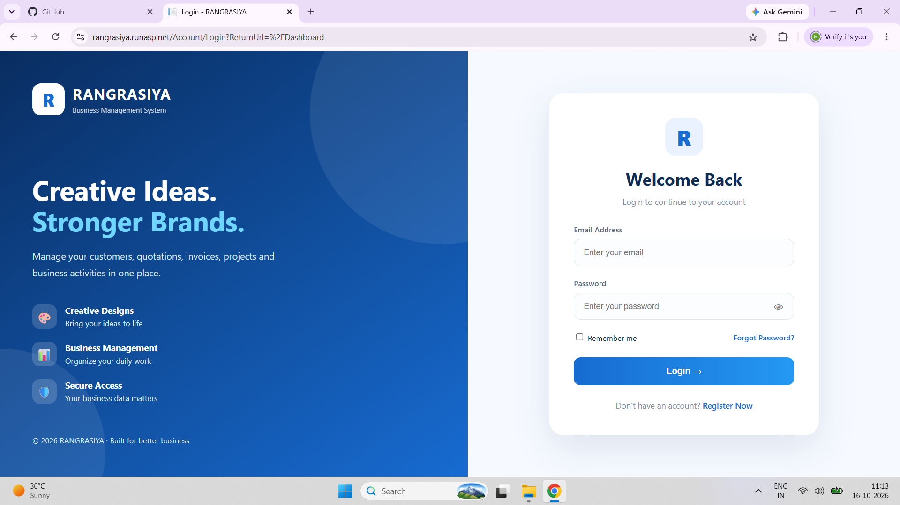
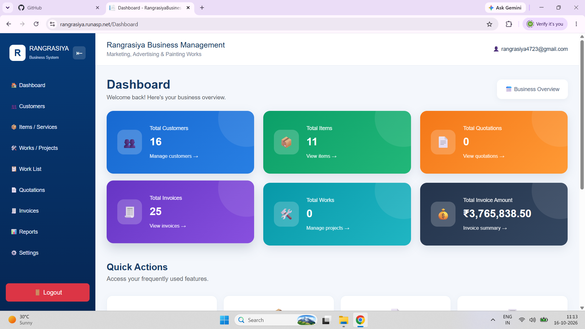
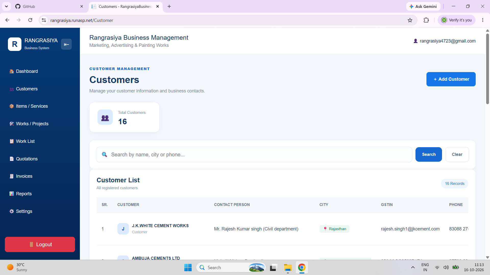
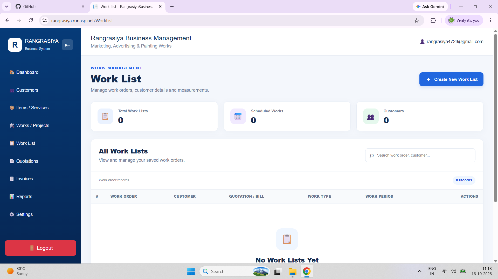
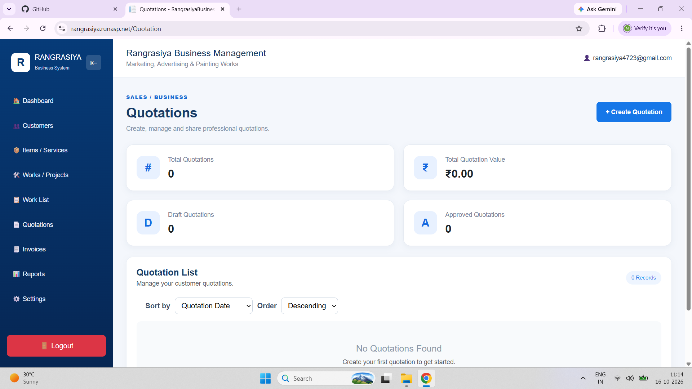
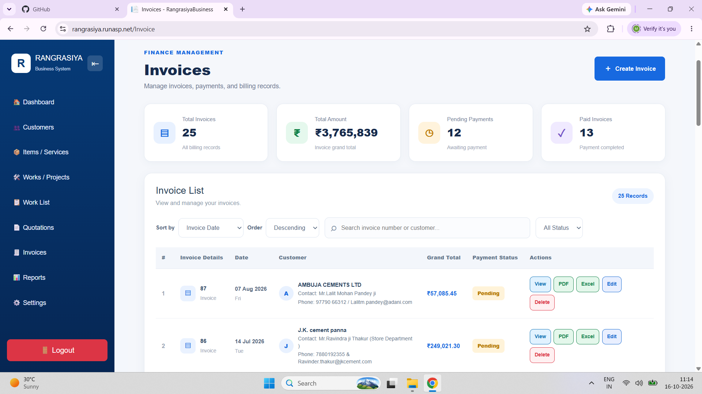
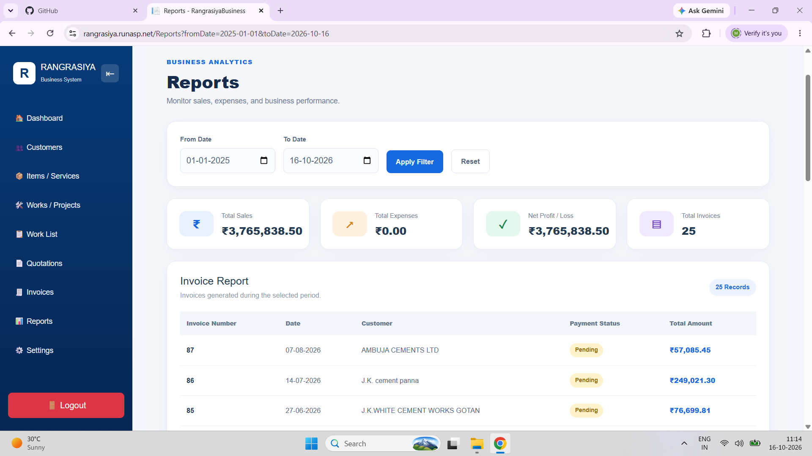

# RangrasiyaBusiness — Business Management System

A web-based business management application designed to manage customers, items and services, work projects, quotations, invoices, and business reports in one place.

## 🌐 Project Links

- **Live Demo:** https://rangrasiya.runasp.net/
- **GitHub Repository:** https://github.com/Manishprajapat3636/RangrasiyaBusiness

## 📸 Application Screenshots

### 1. Login


### 2. Dashboard


### 3. Customer Management


### 4. Items and Services


### 5. Work List


### 6. Quotations


### 7. Invoices


### 8. Reports


## ✨ Features

- **Dashboard:** View an overview of business activities.
- **Customer Management:** Maintain customer records.
- **Items and Services:** Manage service descriptions, units, rates, and GST percentages.
- **Works and Projects:** Organize business work and projects.
- **Work List:** Record work descriptions, locations, measurements, quantities, and calculated totals.
- **Quotation Management:** Create, edit, and manage quotations with multiple line items.
- **Invoice Management:** Create and manage invoices with item details and GST calculations.
- **PDF and Excel Export:** Export supported quotations and invoices.
- **Company Profile:** Configure business information for documents.
- **Terms and Conditions:** Manage quotation terms and conditions.
- **Reports:** Access available business reporting features.

## 🛠️ Technology Stack

- **Backend:** C#, ASP.NET Core MVC
- **Database:** Microsoft SQL Server
- **ORM:** Entity Framework Core
- **Frontend:** HTML, CSS, JavaScript, Bootstrap, Razor Views
- **Database Migrations:** Entity Framework Core Migrations
- **IDE:** Visual Studio
- **Version Control:** Git and GitHub

## 🚀 Run Locally

### Prerequisites

- Visual Studio with ASP.NET and web development tools
- Compatible .NET SDK
- Microsoft SQL Server
- Git

### 1. Clone the Repository

```bash
git clone https://github.com/Manishprajapat3636/RangrasiyaBusiness.git
cd RangrasiyaBusiness
```

### 2. Open the Project

Open `RangrasiyaBusiness.csproj` in Visual Studio.

### 3. Configure the Database

Configure your SQL Server connection string using local configuration or .NET User Secrets. Do not publish database passwords or production credentials.

### 4. Restore Dependencies

```bash
dotnet restore
```

### 5. Apply Database Migrations

After configuring your database connection, run:

```bash
dotnet ef database update
```

Ensure the Entity Framework Core tools are installed and compatible with the project's EF Core version.

### 6. Run the Application

```bash
dotnet run
```

Open the local URL displayed in your terminal.

## 📁 Project Structure

```text
RangrasiyaBusiness/
├── Controllers/
├── Data/
├── Migrations/
├── Models/
├── Services/
├── ViewModels/
├── Views/
├── wwwroot/
├── ScreenShots/
├── .gitignore
├── Program.cs
└── RangrasiyaBusiness.csproj
```

## 🔐 Security

- Keep database credentials and API keys private.
- Do not commit secrets or production configuration files.
- Use environment variables or secure hosting configuration for sensitive settings.
- Restrict access to confidential business data through appropriate authentication and authorization.

## 👨‍💻 Author

**Manish Prajapat**

- **GitHub:** https://github.com/Manishprajapat3636

## 📄 License

No license has been specified yet. Add a license if you intend to allow others to reuse or distribute this project.
